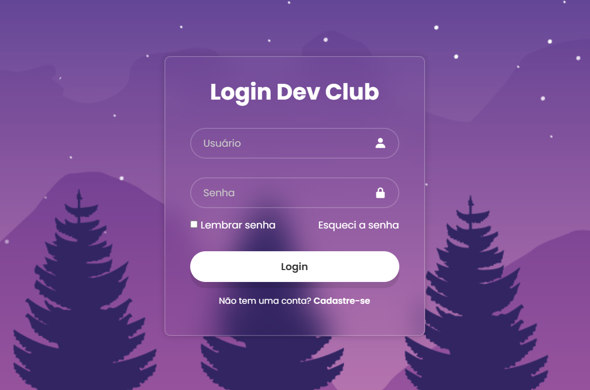

# 🔐 Login Dev Club | Interface de Login

### Uma interface de autenticação com design moderno e estilização em CSS.

  

O **Login Dev Club** é um projeto de interface de autenticação desenvolvido como atividade prática do curso **Transforme-se**, com foco na criação e estilização de formulários utilizando HTML e CSS.

O objetivo é reproduzir uma tela de login moderna, explorando elementos visuais, transparência, efeitos de interação e organização dos componentes.

 

---

## 📖 Sobre o projeto

O **Login Dev Club** foi desenvolvido a partir de uma atividade proposta pelo professor durante o curso **Transforme-se**, com o objetivo de colocar em prática conceitos fundamentais de desenvolvimento Front-End.

A interface apresenta um formulário de login centralizado, com campos para usuário e senha, opção de lembrar senha e links para recuperação de acesso e cadastro.

O design utiliza uma imagem de fundo em tons de roxo, combinada com um formulário semitransparente e efeito de desfoque, criando uma aparência moderna e agradável.

O projeto é voltado ao desenvolvimento visual da página, sem integração com sistemas de autenticação ou banco de dados.

## 🖥️ Prévia do projeto

 

*Interface de login desenvolvida com HTML e CSS.*

---

## ⚙️ Funcionalidades

- **Campo de usuário:** entrada de e-mail para identificação.
- **Campo de senha:** entrada de senha com caracteres ocultos.
- **Lembrar senha:** opção visual de seleção por checkbox.
- **Recuperação de senha:** link demonstrativo para recuperação de acesso.
- **Botão de login:** botão de envio do formulário.
- **Cadastro:** link demonstrativo para criação de conta.
- **Ícones nos campos:** identificação visual dos campos com Boxicons.
- **Efeitos interativos:** alterações visuais ao passar o cursor sobre botões e links.

> **Observação:** este projeto é uma interface Front-End demonstrativa. Os campos e botões não possuem integração com Back-End, autenticação de usuários ou armazenamento de dados.

---

## 🛠️ Tecnologias utilizadas

  

## 📚 Aprendizados

Durante o desenvolvimento deste projeto, foram praticados conceitos importantes de HTML e CSS:

- Estruturação de formulários utilizando HTML5.
- Utilização de campos de entrada com diferentes tipos.
- Organização e centralização de elementos com Flexbox.
- Personalização de formulários e campos de texto.
- Aplicação de imagens de fundo com CSS.
- Utilização de transparência e `backdrop-filter`.
- Criação de efeitos de hover e transições.
- Integração de bibliotecas de ícones e fontes externas.

---

## 👨‍💻 Desenvolvido por Gabriel Oliveira

Projeto desenvolvido como atividade prática do curso **Transforme-se**, com foco no aprendizado de HTML, CSS e construção de interfaces web.

 

